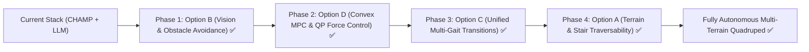

# Implementation Plan: Quadruped Advanced Capability Stack (Options B -> D -> C -> A)

This plan details the phased execution strategy for the Unitree Go2 quadruped platform, progressing through:
1. **Phase 1 (Option B)**: Closed-Loop Vision, Depth Sensing & Reactive Obstacle Avoidance
2. **Phase 2 (Option D)**: Whole-Body Dynamics & Convex MPC / QP Stance Force Control
3. **Phase 3 (Option C)**: Unified Multi-Gait Engine (Walk, Trot, Pace, Bound, Pronk)
4. **Phase 4 (Option A)**: Dynamic Terrain, Stair Climbing & Elevation Traversability

---

## Technical Specifications & Architecture

### Phase 1: Option B — Vision, Depth Sensing & Reactive Obstacle Avoidance
- **Camera Sensor**: Mounted `<camera name="front_cam" ...>` with $60^\circ$ FOV on robot head inside `unitree_go2/go2_description.xml`.
- **Depth Pipeline**: `go2_vision_perception.py` provides offscreen depth extraction and 3-sector clearance analysis (`left`, `center`, `right`) with horizon filtering at row 55 to prevent ground misclassification.
- **Reactive Steering**: Modulates forward velocity and deflects yaw rate away from detected obstacles within proximity bounds.
- **Obstacle Benchmark**: Added `scenarios/obstacle_avoidance.json` with verified $1.79\,\text{m}$ clearance progression.

### Phase 2: Option D — Whole-Body Dynamics & Convex MPC / QP Stance Force Control
- **SRBD Active-Set QP Solver**: `go2_balance_qp.py` optimizes Ground Reaction Forces $f \in \mathbb{R}^{12}$ subject to friction pyramid ($|f_x|, |f_y| \le \mu f_z$) and normal contact bounds ($5\,\text{N} \le f_z \le 180\,\text{N}$).
- **Leg Jacobian Transpose**: Analytic $3 \times 3$ leg Jacobian transpose mapping $\tau_{\text{stance}} = J^T f_{\text{opt}}$ in `go2_champ_control.py`.
- **Performance**: QP solver executes in $<0.2\,\text{ms}$, well within the 500 Hz ($2\,\text{ms}$) real-time loop.

### Phase 3: Option C — Unified Multi-Gait Transition Engine
- **Multi-Gait Scheduler**: `go2_multi_gait.py` manages 5 canonical gaits:
  - **TROT**: Diagonal pairings (FR+RL / FL+RR), duty cycle $0.50$
  - **PACE**: Lateral pairings (FR+RR / FL+RL), duty cycle $0.50$
  - **BOUND**: Sagittal pairings (FR+FL / RR+RL), duty cycle $0.45$
  - **PRONK**: Synchronized 4-leg spring, duty cycle $0.35$
  - **WALK**: 4-beat crawl, duty cycle $0.75$ ($\ge 3$ feet in contact)
- **Smooth In-Flight Blending**: Circular phase offset interpolation prevents mid-stride foot scuffing.
- **Command Schema**: `MotionCommand` extended with `gait: str = "trot"`.

### Phase 4: Option A — Dynamic Terrain, Stair Climbing & Elevation Traversability
- **Procedural Terrain Generator**: `go2_terrain_generator.py` builds procedural MuJoCo environments for:
  - Multi-step staircases (`generate_stairs_xml`, $0.05\,\text{m}$ rise, $0.28\,\text{m}$ run)
  - Inclined slopes & ramps (`generate_slope_xml`, $5^\circ$ to $20^\circ$)
- **MuJoCo Validation**: Generated terrain models parse cleanly in MuJoCo physics with verified collision contacts.
