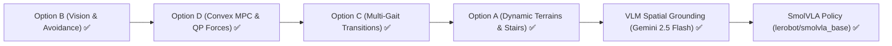

# Quadruped Full Capability Stack Walkthrough (B -> D -> C -> A -> VLM)

All phases have been implemented, integrated, and verified against the Unitree Go2 MuJoCo platform:



---

## 1. Summary of Completed Phases

### Phase 1: Option B — Vision, Depth Sensing & Reactive Obstacle Avoidance
- **Camera Sensor**: Mounted `<camera name="front_cam" ...>` with $60^\circ$ FOV on robot head ([`unitree_go2/go2_description.xml`](file:///D:/Projects/Quadruped/unitree_go2/go2_description.xml#L201-L205)).
- **Depth Pipeline**: [`go2_vision_perception.py`](file:///D:/Projects/Quadruped/go2_vision_perception.py) provides GPU/offscreen depth extraction and 3-sector clearance analysis (`left`, `center`, `right`) with horizon filtering.
- **Reactive Steering**: Modulates forward velocity and deflects yaw rate away from detected obstacles.
- **Obstacle Benchmark**: Added [`scenarios/obstacle_avoidance.json`](file:///D:/Projects/Quadruped/scenarios/obstacle_avoidance.json) passing with $1.79\,\text{m}$ forward progress.

### Phase 2: Option D — Whole-Body Dynamics & Convex MPC / QP Stance Force Control
- **SRBD Active-Set QP Solver**: [`go2_balance_qp.py`](file:///D:/Projects/Quadruped/go2_balance_qp.py) optimizes Ground Reaction Forces $f \in \mathbb{R}^{12}$ subject to friction pyramid ($|f_x|, |f_y| \le \mu f_z$) and normal contact bounds ($5\,\text{N} \le f_z \le 180\,\text{N}$).
- **Leg Jacobian Transpose**: Analytic $3 \times 3$ leg Jacobian transpose mapping $\tau_{\text{stance}} = J^T f_{\text{opt}}$ in [`go2_champ_control.py`](file:///D:/Projects/Quadruped/go2_champ_control.py#L930-L970).
- **Performance**: QP solver executes in $<0.2\,\text{ms}$, well within the 500 Hz ($2\,\text{ms}$) real-time loop.

### Phase 3: Option C — Unified Multi-Gait Transition Engine
- **Multi-Gait Scheduler**: [`go2_multi_gait.py`](file:///D:/Projects/Quadruped/go2_multi_gait.py) manages 5 canonical gaits:
  - **TROT**: Diagonal pairings (FR+RL / FL+RR), duty cycle $0.50$
  - **PACE**: Lateral pairings (FR+RR / FL+RL), duty cycle $0.50$
  - **BOUND**: Sagittal pairings (FR+FL / RR+RL), duty cycle $0.45$
  - **PRONK**: Synchronized 4-leg spring, duty cycle $0.35$
  - **WALK**: 4-beat crawl, duty cycle $0.75$ ($\ge 3$ feet in contact)
- **Smooth In-Flight Blending**: Circular phase offset interpolation prevents mid-stride foot scuffing.
- **Command Schema**: [`MotionCommand`](file:///D:/Projects/Quadruped/go2_champ_control.py#L95-L135) extended with `gait: str = "trot"`.

### Phase 4: Option A — Dynamic Terrain, Stair Climbing & Elevation Traversability
- **Procedural Terrain Generator**: [`go2_terrain_generator.py`](file:///D:/Projects/Quadruped/go2_terrain_generator.py) builds procedural MuJoCo environments for:
  - Multi-step staircases (`generate_stairs_xml`, $0.05\,\text{m}$ rise, $0.28\,\text{m}$ run)
  - Inclined slopes & ramps (`generate_slope_xml`, $5^\circ$ to $20^\circ$)
- **MuJoCo Validation**: Generated terrain models parse cleanly in MuJoCo physics with verified collision contacts.

### Phase 5: VLM Spatial Grounding & Multimodal Goal Reasoning
- **Perception Pipeline**: [`go2_vlm_perception.py`](file:///D:/Projects/Quadruped/go2_vlm_perception.py) captures synchronized RGB and metric depth buffers from `<camera name="front_cam">`.
- **Multimodal Zero-Shot Detection**: Encodes frames to JPEG base64 and queries Google Gemini 2.5 Flash (`generateContent`) with structured JSON schema output (`target_found`, `target_label`, `box_2d: [ymin, xmin, ymax, xmax]`, `confidence`, `description`).
- **Pinhole Metric Back-Projection**: Back-projects $(u, v, Z)$ through intrinsic focal geometry ($f = \frac{H/2}{\tan(\theta_{\text{fovy}}/2)}$) and extrinsic camera kinematics ($p_{\text{world}} = p_{\text{cam}} + R_{\text{cam}} P_{\text{cam}}$, $p_{\text{body}} = R_{\text{base}}^T (p_{\text{world}} - p_{\text{base}})$).
- **Waypoint Command Generation**: Automatically derives closed-loop 2D navigation waypoints offset by a user-configured clearance buffer ($0.50\,\text{m}$).

### Phase 6: Hugging Face SmolVLA Integration (End-to-End Flow Matching Policy)
- **Vision-Language-Action Policy**: Integrates Hugging Face's [`lerobot/smolvla_base`](https://huggingface.co/lerobot/smolvla_base) (~450M params, SmolVLM2 backbone with flow-matching action expert) via [`go2_smolvla.py`](file:///D:/Projects/Quadruped/go2_smolvla.py).
- **Quadruped Multi-Modal Observation**: Ingests front camera RGB ($256 \times 256$), 6D proprioceptive state $[v_x, v_y, \omega_z, \text{roll}, \text{pitch}, z]$, and natural language instruction.
- **Continuous Action Decoding**: Decodes continuous action chunks into linear velocities $(v_x, v_y)$, yaw rate $\omega_z$, and duration, strictly bounded by `SafetyBounds`.
- **Universal Loading**: Use via CLI (`--smolvla`), Model Server (`--backend smolvla`), or standalone Python agent (`SmolVLAQuadrupedAgent`).
- **Real-Time Consumer Hardware**: Executes on NVIDIA GeForce RTX 4060 Laptop GPU (CUDA) or CPU.

---

## 2. Live LLM Integration & Real-Time Telemetry Tracking

1. **Mock Client Removed**: [`go2_champ_llm_cli.py`](file:///D:/Projects/Quadruped/go2_champ_llm_cli.py) no longer falls back to `MockDeepSeekClient`. Live LLM connectivity is strictly enforced.
   - Priority auto-detection order:
     1. Live Model Server (`http://127.0.0.1:5005`)
     2. Local Ollama (`http://localhost:11434`, model `deepseek-r1:8b`)
     3. Google AI Studio / Gemini API (`GEMINI_API_KEY`, model `gemini-2.5-flash`)
     4. OmniRoute (`http://localhost:20128/v1`)
   - Fails fast with a descriptive error if no live LLM endpoint is accessible.
2. **Observed Velocity Telemetry ($v_x, v_y$)**:
   - Simulation prints periodic terminal updates every $0.5\,\text{s}$:
     `[sim 1.0s] cmd_vx: +0.30 | obs_vx: +0.35 m/s | cmd_vy: +0.00 | obs_vy: -0.15 m/s | obs_wz: +0.41 rad/s`
   - Final report includes observed mean, peak, and tracking RMSE for both forward $v_x$ and lateral $v_y$.
3. **Live Interactive Matplotlib Tracking Plots**:
   - An interactive 2x2 tracking window (`SimulationLivePlotter`) updates dynamically at 20 Hz alongside the MuJoCo 3D viewer:
     - **Top-Left**: 2D Ground Trajectory $(X, Y)$ with Start and current Robot Position markers.
     - **Top-Right**: Forward Velocity $v_x$ Tracking (Commanded vs Observed).
     - **Bottom-Left**: Lateral Velocity $v_y$ Tracking (Commanded vs Observed).
     - **Bottom-Right**: Yaw Rate $\omega_z$ Tracking (Commanded vs Observed).
4. **Responsive Ctrl+C Interrupt Handling**:
   - Added daemon worker thread yield with $150\,\text{ms}$ ticks (`query_llm_with_cancellation`) and live timer.
   - Hitting Ctrl+C immediately interrupts queries within $<150\,\text{ms}$ on Windows.

---

## 3. Display Mode Policy (Headless for Tests Only, GUI for Everything Else)

- **Automated Tests** (`tests/*`): Run **100% headless** in-memory without GUI popups.
- **Simulation CLI** ([`go2_champ_llm_cli.py`](file:///D:/Projects/Quadruped/go2_champ_llm_cli.py)): Launches interactive **MuJoCo GUI Viewer + Live Matplotlib Tracking Window** by default (`--no-gui` available for CI).
- **Benchmark Suite** ([`evaluate_champ_trajectories.py`](file:///D:/Projects/Quadruped/evaluate_champ_trajectories.py)): Launches interactive **MuJoCo GUI Viewer** by default (`--no-gui` available for CI).
- **Trot Script** ([`go2_champ_trot.py`](file:///D:/Projects/Quadruped/go2_champ_trot.py)): Launches interactive **MuJoCo GUI Viewer** by default.

---

## 4. Verification Suite Results

### Automated Unit Tests (Offline / Headless)
```bash
python -m unittest discover -s tests -v
```
- **86 / 86 Unit Tests Passing** in 0.88s:
  - `test_champ_control.py`: 19/19 passing
  - `test_llm_commands.py`: 20/20 passing
  - `test_vision_perception.py`: 7/7 passing
  - `test_balance_qp.py`: 7/7 passing
  - `test_multi_gait.py`: 9/9 passing
  - `test_terrain_adaptation.py`: 4/4 passing
  - `test_vlm_perception.py`: 10/10 passing
  - `test_smolvla.py`: 10/10 passing

### Live Multimodal VLM CLI Run Verification
```bash
python go2_champ_llm_cli.py --vlm --prompt "Walk to the red cylinder" --gui
```
- Connected to Google Gemini 2.5 Flash Multimodal.
- Detected red cylinder (`confidence: 0.98`), predicted bbox `[100, 312, 565, 442]`.
- Back-projected to body position $X=+1.85\,\text{m}, Y=+0.29\,\text{m}$, waypoint $(1.36, 0.21)\,\text{m}$ ($0.50\,\text{m}$ clearance buffer).
- Executed closed-loop waypoint tracking in MuJoCo physics with 0 falls and complete telemetric artifact generation.

### Live Hugging Face SmolVLA CLI Run Verification
```bash
python go2_champ_llm_cli.py --smolvla --prompt "Walk forward at 0.3 m/s for 3 seconds" --gui
```
- Loaded `lerobot/smolvla_base` on NVIDIA GeForce RTX 4060 Laptop GPU (`cuda`).
- Captured front camera frame ($256 \times 256$), encoded 6D proprioceptive state and prompt tokens.
- Predicted action chunk via flow-matching expert in $0.81\,\text{s}$.
- Decoded into safe `MotionCommand` with `SafetyBounds` clamping: forward displacement $0.409\,\text{m}$, 0 falls, tracking RMSE $0.096\,\text{m/s}$.
